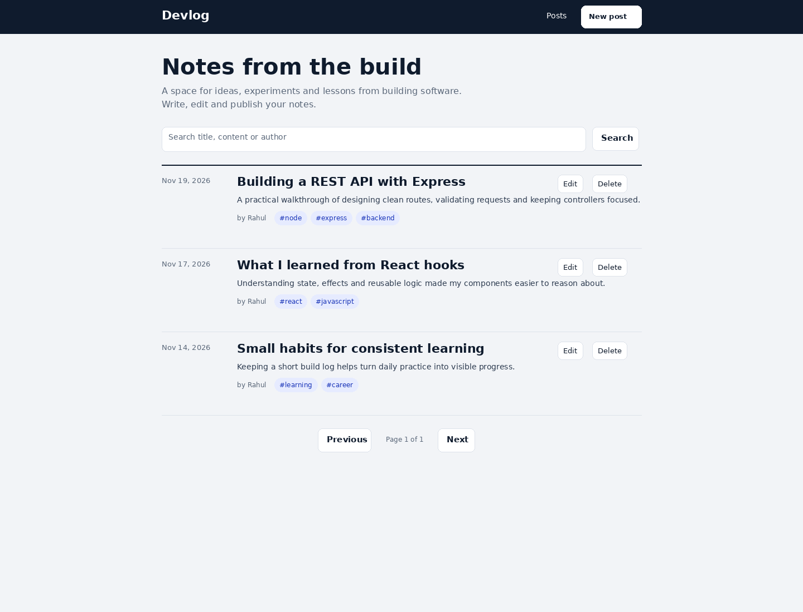
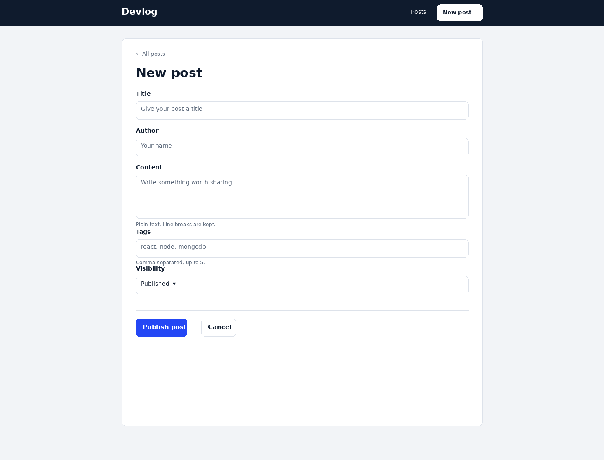
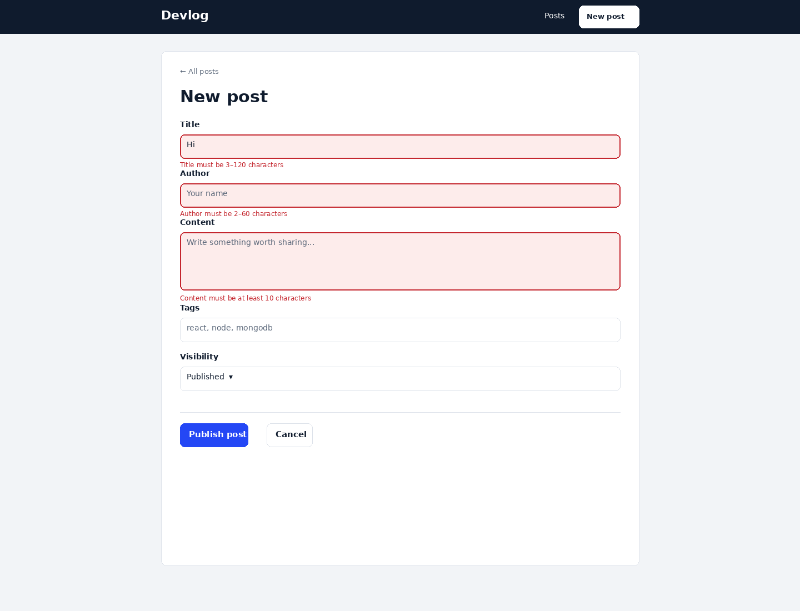
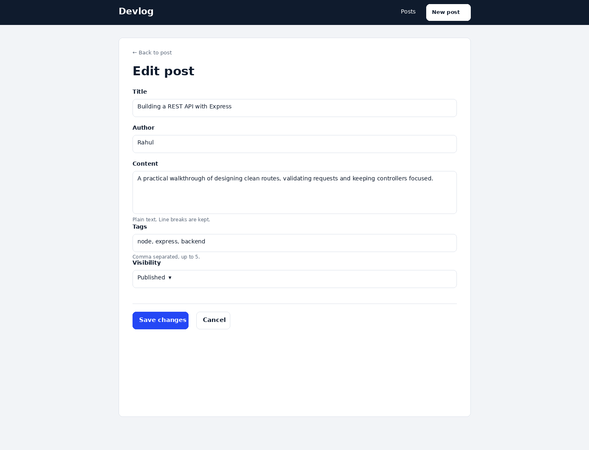
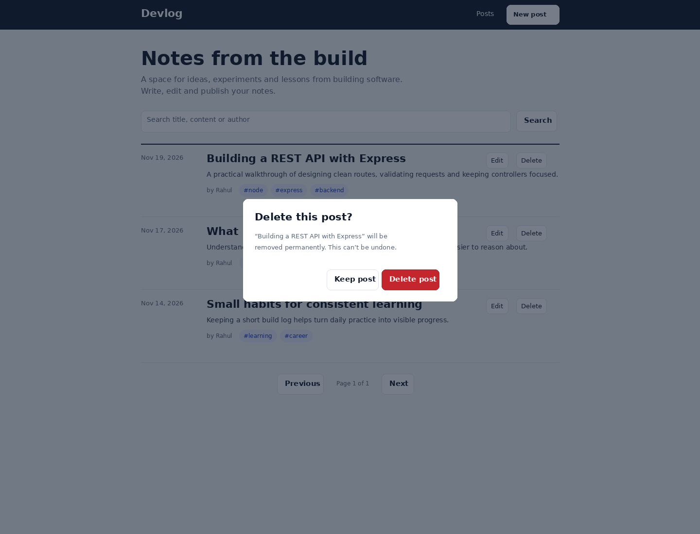
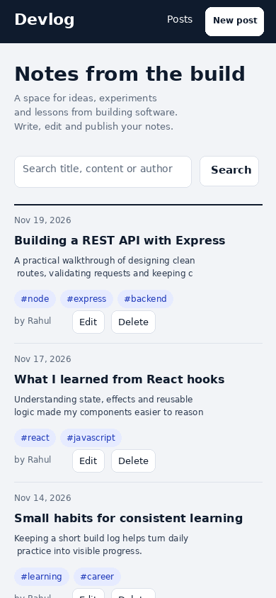

<div align="center">

# 📝 Devlog: React Blog connected to Express + MongoDB

**Week 5 · Connect Frontend to Backend**: a React blog with list, create, edit and delete wired to a live API.


</div>

---

## 📑 Table of Contents
1. [Task Description](#-task-description)
2. [Features](#-features)
3. [Tech Stack](#-tech-stack)
4. [Project Structure](#-project-structure)
5. [Installation & Setup](#-installation--setup)
6. [Running the Project](#-running-the-project)
7. [How the Frontend Talks to the API](#-how-the-frontend-talks-to-the-api)
8. [API Reference](#-api-reference)
9. [Screenshots](#-screenshots)
10. [Testing](#-testing)
11. [Deployment Notes](#-deployment-notes)
12. [Troubleshooting](#-troubleshooting)

---

## 🎯 Task Description
> **Week 5: Connect frontend to backend**: Integrate the React blog with your API (list, create, edit, delete posts).

The React app in `client/` talks to the Express + MongoDB API in `server/`. Both are included so the whole project runs from this one ZIP.

## ✨ Features
- **List** posts with pagination (5 per page), search, and click-a-tag filtering
- **Read** a post on its own page
- **Create** and **Edit** with one shared form, client-side validation, and server errors shown under the right field
- **Delete** with a confirmation dialog (from the list or the post page)
- Loading, empty and error states on every screen, including a retry button
- Clear message when the API is unreachable
- Shareable URLs for pages, search and filters (React Router)
- Responsive layout, keyboard focus styles, skip link, reduced-motion support

## 🧰 Tech Stack
| Layer | Tools |
|---|---|
| Frontend | React 18, React Router 6, Vite 5, plain CSS |
| Backend | Node.js 18+, Express 4, express-validator |
| Database | MongoDB with Mongoose 8 |

## 📁 Project Structure
```
Internship_Task/
├── Source_Code/
│   ├── client/                        # React frontend
│   │   ├── src/
│   │   │   ├── api.js                 # API client (fetch wrapper + error handling)
│   │   │   ├── App.jsx                # Layout and routes
│   │   │   ├── pages/
│   │   │   │   ├── PostList.jsx       # List, search, filter, delete
│   │   │   │   ├── PostDetail.jsx     # Single post
│   │   │   │   └── PostForm.jsx       # Create and edit
│   │   │   ├── components/            # ConfirmDialog, Toast, helpers
│   │   │   └── styles.css
│   │   ├── vite.config.js             # Dev proxy: /api → :5000
│   │   └── package.json
│   └── server/                        # Express + MongoDB API
│       ├── src/ (config, models, controllers, routes, middleware)
│       ├── tests/api.test.js
│       └── package.json
├── Output/
│   ├── api-test-results.txt           # 18 API tests passing
│   └── screenshots/                   # ← add your screenshots here (see below)
└── README.md
```

## ⚙️ Installation & Setup
**Requirements:** Node.js 18+ and MongoDB (local, Docker, or free [MongoDB Atlas](https://www.mongodb.com/atlas)).

**1. Backend**
```bash
cd Source_Code/server
npm install
cp .env.example .env          # Windows: copy .env.example .env
```
Set `MONGODB_URI` in `.env` if you are not using local MongoDB. No local MongoDB? `docker run -d -p 27017:27017 mongo:7`

**2. Frontend**
```bash
cd Source_Code/client
npm install
```

## ▶️ Running the Project
Use **two terminals**.

**Terminal 1: API**
```bash
cd Source_Code/server
npm run seed      # optional: adds 3 sample posts
npm start         # → http://localhost:5000
```

**Terminal 2: React app**
```bash
cd Source_Code/client
npm run dev       # → http://localhost:5173
```
Open **http://localhost:5173**. Posts you create show up in MongoDB and survive a page refresh.

## 🔌 How the Frontend Talks to the API
All network code lives in one file, `client/src/api.js`.

```js
api.list({ page, limit, search, tag })   // GET    /api/posts
api.get(id)                              // GET    /api/posts/:id
api.create(post)                         // POST   /api/posts
api.update(id, post)                     // PUT    /api/posts/:id
api.remove(id)                           // DELETE /api/posts/:id
```

- **No CORS setup needed in development.** Vite proxies `/api` to `http://localhost:5000` (see `vite.config.js`).
- **Errors are normalised.** The client throws an `ApiError` with a `message`, a `status`, and `fieldErrors` (e.g. `{ title: "Title must be 3-120 characters" }`) that the form displays beside the matching input.
- **Network failures** produce a readable message instead of a blank page.

| User action | Request | UI result |
|---|---|---|
| Open home | `GET /api/posts?page=1&limit=5` | List renders (or loading, empty, error state) |
| Search / click tag | `GET /api/posts?search=…` / `?tag=…` | List filters, URL updates |
| Publish post | `POST /api/posts` | Redirects to the new post, toast shown |
| Save changes | `PUT /api/posts/:id` | Redirects to the post, toast shown |
| Confirm delete | `DELETE /api/posts/:id` | List refreshes, toast shown |

## 📡 API Reference
Base URL: `http://localhost:5000/api`

| Method | Endpoint | Description |
|---|---|---|
| `GET` | `/health` | Server and DB status |
| `GET` | `/posts?page&limit&search&tag&status` | List posts (paginated) |
| `POST` | `/posts` | Create |
| `GET` | `/posts/:id` | Read one |
| `PUT` / `PATCH` | `/posts/:id` | Update |
| `DELETE` | `/posts/:id` | Delete |

**Post fields:** `title` (3–120), `author` (2–60), `content` (10–10,000), `tags` (max 5), `status` (`draft` / `published`). Validation errors return `400` with `{ message, errors: [{ field, message }] }`.

## 📸 Screenshots
The six images below are **illustrative UI mockups** prepared from this project's existing stylesheet and component layout, using representative sample content. They are included to show the intended appearance of each state. They were **not captured from a running React application**, and therefore do not prove live browser behavior or API connectivity. Before presenting this as runtime evidence, replace them with screenshots captured from your own running app.

| Home (list) | Create post |
|---|---|
|  |  |

| Validation errors | Edit post |
|---|---|
|  |  |

| Delete confirmation | Mobile view |
|---|---|
|  |  |

## 🧪 Testing
Backend integration tests run against a real MongoDB:
```bash
cd Source_Code/server && npm test
```
The included output records an earlier 18-test run; two additional validation tests were added during review and still need to be run locally. The API test output is included in `Output/api-test-results.txt`. The React UI still requires a local browser smoke test using the checklist below; do not treat the recorded API tests as proof of browser click-testing.

**Manual checklist**
- [ ] Home shows posts; search and tag filter work
- [ ] Create a post, then it appears in the list after refresh
- [ ] Submit an empty form and see errors under the fields
- [ ] Edit a post and see the change saved
- [ ] Delete a post, confirm in the dialog, and see it removed
- [ ] Stop the API and reload: a clear error with **Try again** appears

## 🚀 Deployment Notes
- Build the frontend: `cd Source_Code/client && npm run build` (output in `dist/`).
- Deploy the API (Render, Railway, etc.) with `MONGODB_URI` and `CLIENT_ORIGIN` set to your frontend URL.
- Set `VITE_API_URL` to the deployed API origin **before** building the frontend.
- For static hosts (Netlify/Vercel), add a rewrite of all routes to `/index.html` so React Router URLs work on refresh.

## 🛠️ Troubleshooting
| Problem | Fix |
|---|---|
| "Cannot reach the server" in the UI | The API is not running. Start Terminal 1 |
| API exits with `ECONNREFUSED 127.0.0.1:27017` | MongoDB is not running, or fix `MONGODB_URI` |
| Port 5000 busy (macOS AirPlay) | Change `PORT` in `server/.env` and set `VITE_API_PROXY=http://localhost:<port>` when running the client |
| Blank page after deploy on refresh | Add the SPA rewrite described above |

---
<div align="center">Built for the SDM Technology internship · Week 5</div>
